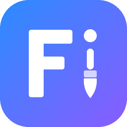
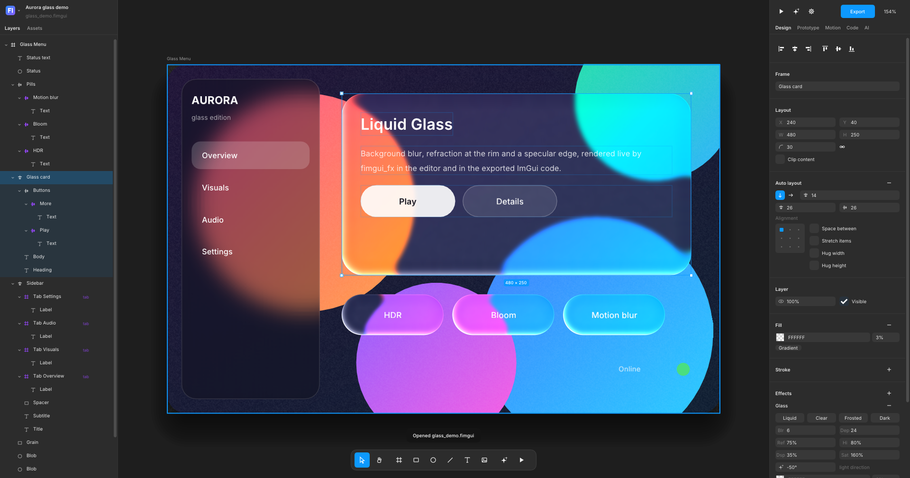
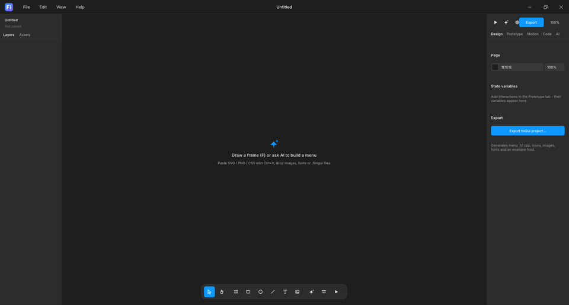
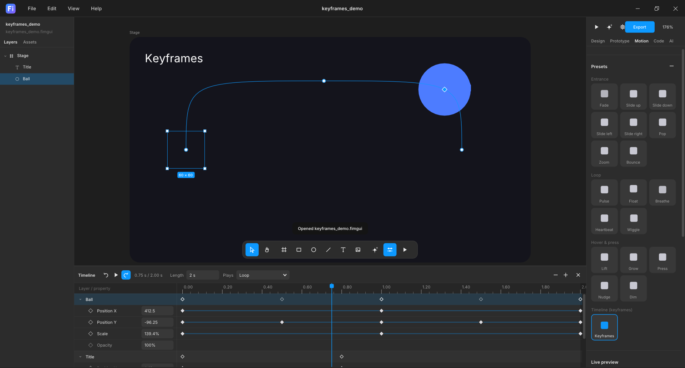

<p align="center"></p>

# Fimgui

Редактор интерфейсов для **Dear ImGui** и **Minecraft (Java Edition)**, дизайн которого вдохновлён Figma. Меню рисуется на холсте вручную или по текстовому запросу к Claude: модель передаёт операции потоком, и они сразу появляются на холсте. Экспорт даёт готовую папку: `menu.h/.cpp`, иконки (SVG и PNG), изображения, шрифты и пример хоста на DirectX 11 — или Screen для Fabric / NeoForge 1.21.1 с текстурами и шрифтами.



Как это выглядит в работе — меню собирается из потока операций, как при ответе ИИ, а в конце включается превью с анимациями:



> Fimgui — бесплатный инструмент: делайте в нём любые проекты, в том числе на продажу. **Продавать сам Fimgui нельзя** — см. [LICENSE](LICENSE). Проект не связан с Figma, Inc.; Figma — товарный знак Figma, Inc.

## Сборка

Нужны Windows 10/11, Visual Studio 2022 или 2026 с компонентом C++ и CMake 3.20+.

```bat
cmake -S . -B build
cmake --build build --config Release
build\Release\Fimgui.exe examples\demo_menu.fimgui
```

Все зависимости лежат в `third_party/`: Dear ImGui (ветка docking, 1.93), FreeType 2.13.3 (растеризация шрифтов с хинтингом), nanosvg, stb_image, nlohmann/json. Шрифт Inter (лицензия OFL) лежит в `resources/fonts`. После сборки рядом с exe копируются `runtime/` (его экспортёр кладёт в каждый проект) и `resources/`.

## Установка и обновления

Готовые сборки лежат в [Releases](https://github.com/dis3j/FImgui/releases): скачайте `FImgui-vX.Y.Z-win64.zip`, распакуйте и запустите `Fimgui.exe`.

При запуске Fimgui проверяет последний релиз на GitHub. Если вышла новая версия, появится окно с её патчноутом и кнопкой **Download on GitHub** — откроется страница релиза, архив скачивается оттуда. Можно нажать «Later» или «Skip this version». Проверить вручную: **Help → Check for updates**. После обновления один раз показывается окно **What's new**, потом его можно открыть через Help.

### Как выпускается релиз

У каждой версии обязателен патчноут.

1. Поднимите `FIMGUI_VERSION` в `src/version.h`.
2. Добавьте в [CHANGELOG.md](CHANGELOG.md) раздел `## X.Y.Z` с описанием изменений.
3. Запушьте тег: `git tag vX.Y.Z && git push origin vX.Y.Z`.

Workflow `.github/workflows/release.yml` проверяет, что тег совпадает с версией и патчноут есть, собирает проект и публикует релиз с архивом; текст раздела CHANGELOG становится описанием релиза. Без патчноута или при ошибке сборки релиз не публикуется. Workflow `build.yml` собирает каждый пуш в main и тоже требует патчноут для текущей версии.

Форк может направить проверку обновлений на свой репозиторий через переменную окружения `FIMGUI_UPDATE_REPO=owner/repo`.

## Интерфейс

- Свой заголовок окна вместо системного: логотип (открывает Projects), меню **File / Edit / View / Help**, название проекта, кнопки окна. Перетаскивание за пустое место, двойной клик разворачивает окно, работают Aero Snap и ресайз за края.
- Размер интерфейса: **View → Interface scale** (100–175%, по умолчанию 115%).
- Панель Design устроена как в Figma: подписи над полями, разделы Position, Layout, Appearance, Typography, Fill, Stroke, Effects, Export. У Fill и Stroke есть «глаз» — заливку или обводку можно скрыть, не удаляя; эффекты показаны списком и раскрываются по клику.
- **Колорпикер** открывается по квадратику цвета. Вкладки сверху: Solid, Gradient (стопы и угол), Pattern (шум, линии, сетка, полосы, точки, шахматка), Image, Video, Shader (Aurora, Mesh, Waves, Radial glow, Plasma — запекаются в текстуру 256 px), режим наложения заливки и проверка контраста WCAG против фона под слоем. Ниже — квадрат насыщенности, пипетка (берёт цвет с экрана), оттенок, прозрачность, Hex / RGB / HSL / HSB и цвета со страницы.

## Таймлайн и ключевые кадры

**Alt+T**, кнопка на нижней панели или пресет **Keyframes** во вкладке Motion открывают таймлайн под холстом:




- линейка времени и плейхед (тяните по линейке), Play / Pause, возврат в начало, Loop, длина таймлайна и способ запуска: при появлении, в цикле, по наведению, нажатию или активному состоянию;
- у каждого слоя дорожки **Position X**, **Position Y**, **Scale**, **Opacity**: ромб слева ставит или убирает ключ в позиции плейхеда, поле справа меняет значение (ключ создаётся сам), двойной клик по дорожке добавляет ключ;
- клик по ключу выделяет его (Shift / Ctrl — несколько), ключи перетаскиваются по времени (шаг 0,01 с, с Alt — без шага), Del или кнопка «Delete key» удаляют выбранные, правый клик — easing до следующего ключа;
- на холсте у выбранного слоя видна траектория движения; её точки можно перетаскивать.

Ключевые кадры экспортируются в C++ (статические массивы в `menu.cpp`), в Java и в CSS (`@keyframes`).

## Проекты

Все проекты лежат в рабочей папке — по умолчанию `C:\FImgui`, путь меняется на экране Projects. Каждый проект — отдельная папка:

```
C:\FImgui\
  Project_A\
    projecta.fimgui     дизайн: слои, стили, анимации; ассеты хранятся ссылками на файлы
    fonts\              используемые шрифты копируются сюда при сохранении — проект переносим
    images\             PNG, JPG, GIF
    icons\              SVG
    videos\             MP4, MOV, WMV
    export\             сюда по умолчанию экспортируется C++ (настройки экспорта хранятся в проекте)
    thumbnail.png       превью для экрана проектов
```

- **Projects** (Ctrl+Shift+O, открывается при запуске): сетка проектов с превью, поиск, «+ New project», недавние файлы.
- **Ctrl+N** создаёт новый проект. **Ctrl+S** у несохранённого дизайна предлагает сохранить его как проект, у проекта — сохраняет папку целиком.
- Папку проекта можно скопировать на другой компьютер: шрифты проекта регистрируются при открытии, ассеты читаются из файлов.
- «Save as single file» сохраняет автономный `.fimgui` со встроенными ассетами, как раньше.
- MCP-инструмент `document_file` умеет `list_projects`, `new_project` и `open_project`.

## Возможности

**Редактор**
- Интерфейс как в Figma: панель слоёв слева, бесконечный холст, плавающий тулбар снизу, справа вкладки Design / Prototype / Code / AI.
- Слои: Frame, Group, Rectangle, Ellipse, Line, Text, Image, Vector (SVG).
- Перемещение, ресайз за углы и края, привязка к соседним слоям с красными направляющими. Alt+перетаскивание дублирует слой, Shift ограничивает ось или сохраняет пропорции.
- Auto layout: направление, gap, padding, сетка выравнивания 3×3, space-between, stretch, hug, fill container.
- Скругления (каждый угол отдельно), заливка сплошным цветом или линейным градиентом, обводка inside/center/outside, тени drop и inner, прозрачность, обрезка содержимого.
- Текст: любой системный шрифт и стиль, межстрочный интервал, выравнивание, режимы auto width / auto height / fixed, редактирование двойным кликом прямо на холсте.
- Пиксельная работа: начиная с **400%** поверх холста появляется пиксельная сетка (Shift+'); **Snap to pixel grid** округляет позиции и размеры до целых пикселей (Ctrl+Shift+'); **Pixel preview** (Ctrl+Alt+Y) рисует страницу в 1× и увеличивает без сглаживания — видно реальные пиксели, как их отрисует ImGui.
- Undo/redo, группировка, порядок слоёв, перетаскивание слоёв в дереве, файлы `.fimgui` в формате JSON.

**Копирование и вставка**

| Действие | Как |
|---|---|
| Copy as CSS / SVG / PNG / ImGui-код / JSON | ПКМ → Copy as, кнопки в Design → Export, вкладка Code |
| Вставить SVG-текст | Ctrl+V создаёт Vector-слой |
| Вставить картинку из буфера | Ctrl+V создаёт Image-слой |
| Вставить CSS | Ctrl+V применяет стили к выделенным слоям, а без выделения создаёт новый слой |
| Перетащить файлы | PNG/JPG/SVG — на холст, TTF/OTF — добавить шрифт, `.fimgui` — открыть |

Из Figma удобнее всего копировать через **Copy as SVG / PNG / CSS**. Собственный формат буфера обмена Figma не поддерживается.

**Интерактивность (вкладка Prototype)**

Каждой роли соответствует поведение ImGui в экспортированном коде:
- `Button` — клик записывает значение в переменную, в `State` появляется флаг `<name>_pressed`.
- `Checkbox / Toggle` — переменная `bool`.
- `Slider` — переменная `float`; дочерние слои с ролью *Fill* и *Knob* двигаются вместе со значением.
- `Tab` — переменная `int`; страницы показываются через **Show when** `tab == N`.
- `Input` — `char[256]`, а дочерний текст становится плейсхолдером.
- `Combo` — выпадающий список, выбор одного пункта из двух и более. Переменная `int` хранит индекс.
- `Multi-combo` — выпадающий список с чекбоксами, можно выбрать несколько пунктов или все. Переменная `unsigned int` — битовая маска; в C++ пункты подписаны в комментарии. Есть строка «выбрать всё», до 24 пунктов.
- У комбо поле — это ваш фрейм, а выбранное значение показывает дочерний текст `{var:label}`: пункт, «A, B», текст «все» или «ничего». Кнопка **Add value + arrow** создаёт этот текст и стрелку. Фон, акцент и высоту пунктов списка можно настроить, шрифт и цвет текста берутся из подписи.
- Цвета hover и active/checked анимируются. Текст может выводить значения переменных: `FOV: {fov:%.0f}°`.
- ▶ **Preview** (Ctrl+Enter) — меню на холсте становится интерактивным.

**Эффекты (Design → Effects → +)**
- **Drop / Inner shadow** — как раньше.
- **Background blur** — размывает всё, что под слоем. Заливка слоя тонирует размытие, поэтому сделайте её полупрозрачной.
- **Glass** — «жидкое стекло» в духе Apple: размытие, преломление фона у кромки, блик по направлению света и хроматическая дисперсия. Есть пресеты Liquid / Clear / Frosted / Dark, все параметры настраиваются (blur, глубина кромки, преломление, блик, дисперсия, насыщенность, угол света, тон). Лучше всего смотрится поверх ярких градиентов и картинок.
- **Texture overlay** — PNG/JPG, анимированный GIF или видео (MP4/MOV/WMV) поверх заливки. Режимы смешивания Normal / Add / Multiply / Screen, вписывание Fill / Fit / Tile, масштаб тайла и прокрутка (px/с). Встроены генераторы тайлов Noise, Lines, Grid, Diag — например, для зерна.

GIF и видео можно класть и как обычные слои-изображения: перетащите файл на холст.

**Анимации (вкладка Motion)**
- Галерея пресетов, у каждого живое превью:
  - появление: Fade, Slide ×4, Pop, Zoom, Bounce;
  - циклы: Pulse, Float, Breathe, Heartbeat, Wiggle;
  - реакции на курсор: Lift, Grow, Press, Nudge, Dim — по hover, press или active (checked / выбранная вкладка).
- Live preview слоя, длительность и задержка, 8 кривых easing плюс свой cubic-bezier с перетаскиваемыми ручками на графике. Для групп есть **Stagger children** — дети появляются по очереди.
- **Timeline** показывает все анимированные слои текущего фрейма. Кнопка **Play on canvas** проигрывает анимацию прямо на холсте, в **Preview** анимации работают вместе с интерактивом.
- Анимация появления срабатывает, когда слой становится видимым: при открытии меню и при переключении вкладки или страницы.
- Движок анимаций общий у редактора и экспорта (`fim::AnimUpdate`), поэтому в C++ движение такое же. В Code → CSS анимации выгружаются как `@keyframes`.

## ИИ (Claude)

1. Откройте ⚙ Settings и укажите API-ключ. Ключ хранится в `%APPDATA%\Fimgui\settings.json` и зашифрован через Windows DPAPI под вашим пользователем. Можно не указывать ключ в настройках, а задать переменную окружения `ANTHROPIC_API_KEY`.
2. Откройте вкладку **AI** (Ctrl+I) и опишите меню, например: «тёмное меню 720×480, слева вкладки Aimbot / Visuals / Misc с иконками, тумблеры и слайдеры».
3. Модель отвечает потоком JSON-операций (`create`, `update`, `delete`, `move`, `svg`). Каждая строка применяется, как только пришла, поэтому меню достраивается у вас на глазах. Весь ответ откатывается одним Ctrl+Z.

Подробности:
- По умолчанию используется модель `claude-opus-5-5`. Можно выбрать Sonnet 5.5 (быстрее), Haiku 5.5 (самая быстрая) или Fable 5.1 (самая сильная).
- Effort настраивается от low до max. Чем ниже effort, тем быстрее рисует модель.
- Включены adaptive thinking (его краткое изложение видно в чате) и серверный `fallbacks: "default"` на случай отказа модели. System prompt кешируется.
- Модель знает про эффекты и анимации: попросите, например, «сделай карточки стеклянными, добавь зерно на фон и плавное появление вкладок».
- Вместе с запросом уходят JSON документа и, если включено, PNG-снимок холста, чтобы модель видела текущий результат. Можно приложить референс-скриншот: 📎 или Ctrl+V в поле ввода.

## MCP: работа из Claude Desktop, Claude Code и других клиентов

Fimgui поднимает MCP-сервер, поэтому общаться с ИИ можно прямо в вашем MCP-клиенте: он читает и меняет дизайн, а изменения сразу появляются на холсте. Встроенный чат с API-ключом остаётся и работает независимо.

- Сервер слушает только `127.0.0.1`. Адрес по умолчанию — `http://127.0.0.1:7317/mcp` (транспорт Streamable HTTP).
- Порт и включение настраиваются в ⚙ Settings → MCP server. Там же кнопки, которые копируют готовую команду или конфиг.
- Статус и журнал вызовов видны во вкладке AI.

**Claude Code:**
```
claude mcp add --transport http fimgui http://127.0.0.1:7317/mcp
```

**Claude Desktop** и другие клиенты, которые запускают сервер как процесс: используйте stdio-мост `fimgui-mcp.exe`, он собирается рядом с `Fimgui.exe`. Если редактор не запущен, мост откроет его сам. Добавьте в `claude_desktop_config.json`:
```json
{
  "mcpServers": {
    "fimgui": { "command": "C:\\Work\\Fimgui\\build\\Release\\fimgui-mcp.exe", "args": ["--port", "7317"] }
  }
}
```

**Инструменты:**

| Инструмент | Что делает |
|---|---|
| `get_design_guide` | Модель узлов, эффекты, анимации, роли и формат операций — то же, что знает встроенный чат |
| `get_document` | JSON дизайна или поддерева, выделение, переменные состояния, шрифты |
| `apply_operations` | Пакет операций `create` / `update` / `delete` / `move` / `svg` / `select` / `clear` на живом холсте |
| `render_image` | PNG страницы или слоя, чтобы модель видела результат |
| `get_code` | Код слоя: ImGui C++, CSS, SVG или JSON |
| `import_media` | Импорт PNG/JPG/SVG/GIF/видео с диска, как слой или только как ассет |
| `export_project` | Экспорт C++-проекта в папку |
| `preview` | Включить или выключить превью, проиграть анимацию слоя |
| `history` | Undo / redo |
| `document_file` | Новый документ / открыть / сохранить. Несохранённые изменения не сбрасываются без `discard_changes` |

Попросите в клиенте, например: «нарисуй в Fimgui тёмное меню с вкладками и стеклянными карточками, потом покажи скриншот».

## Экспорт

Кнопка **Export** (Ctrl+E) создаёт такую папку:

```
<out>/
  menu/menu.h, menu.cpp         сгенерированный код: namespace, State, Init, Render
  menu/menu_assets.cpp          иконки и картинки внутри бинарника (+ шрифты, если включено)
  menu/fimgui_runtime.h/.cpp    функции отрисовки и анимаций, GIF — общие с редактором
  menu/fimgui_fx.h, fimgui_fx_dx11.cpp   blur, glass, режимы смешивания, видео (DirectX 11)
  menu/fimgui_fx_null.cpp       заглушка для других рендереров (полупрозрачная заливка вместо blur)
  menu/stb_image.h
  icons/*.svg, *.png            векторные иконки и их растровые версии (масштаб 1–4x)
  images/                       растровые изображения и GIF
  videos/                       видеофайлы
  fonts/*.ttf                   использованные шрифты
  example/main.cpp, CMakeLists.txt   хост Win32 + DX11 (укажите IMGUI_DIR)
  menu.fimgui                   исходник дизайна
```

Подключение:

```cpp
#include "menu.h"

menu::State state;
fim::fx::InitDX11(device, context);           // один раз после ImGui_ImplDX11_Init()
menu::Init(MyCreateTexture, "fonts", ".");    // шрифты; папка, внутри которой лежит videos/

// каждый кадр между NewFrame() и Render():
menu::Render(state);
if (state.Save_config_pressed) SaveConfig();
```

Эффекты DX11 линкуются с `d3dcompiler mfplat mfreadwrite mfuuid shlwapi` (в `example/CMakeLists.txt` это уже сделано). На OpenGL, Vulkan и других рендерерах подключите `fimgui_fx_null.cpp` вместо `fimgui_fx_dx11.cpp`: всё остальное работает, только blur и стекло упрощаются до полупрозрачной заливки, а видео не проигрывается.

Каждый фрейм верхнего уровня становится отдельным окном ImGui, которое можно перетаскивать за пустые места. Нужен Dear ImGui **1.92 или новее**: используются динамические размеры шрифтов. Редактор рисует холст тем же `fimgui_runtime`, поэтому экспорт выглядит так же, как в редакторе.

## Экспорт в Minecraft (Java)

В окне **Export** выберите **Minecraft Java**, загрузчик (**Fabric 1.21.1** с именами Yarn или **NeoForge 1.21.1** с именами Mojang), mod id и Java-пакет. Экспортируется первый фрейм верхнего уровня:

```
<out>/
  src/main/java/<package>/
    NexusMenu.java          дизайн: поля состояния, раскладка, взаимодействие, анимации (не зависит от загрузчика)
    NexusScreen.java        Screen и адаптер отрисовки для выбранного загрузчика
    fimgui/                 Java-runtime Fimgui: FimAnim, FimUi, FimGfx
  src/main/resources/assets/<modid>/
    textures/gui/<menu>/    запечённые слои (заливки, градиенты, обводки, тени, картинки, иконки) в 2x
    font/                   шрифты дизайна как TTF-провайдеры
  README.md, LICENSE-FIMGUI.txt
```

Скопируйте `src/` в свой мод и откройте экран: `MinecraftClient.getInstance().setScreen(new NexusScreen())` (Fabric) или `Minecraft.getInstance().setScreen(new NexusScreen())` (NeoForge). Состояние доступно как публичные поля: `screen.menu.fov`, `screen.menu.aim_enabled`, …

- Прямоугольники без скруглений и эффектов рисуются через `fill`, всё сложнее запекается в текстуру слоя; у кнопок с hover / active цветами запекаются варианты и плавно сменяются.
- Кнопки, вкладки, чекбоксы, слайдеры, Combo / Multi-combo и поля ввода работают как в превью; анимации (пресеты и ключевые кадры) считаются тем же кодом, что в редакторе.
- Меню вписывается в окно и центрируется.
- Ограничения: blur и стекло запекаются без мира за ними, GIF и видео показывают первый кадр, шрифты подключаются только в формате TTF.

## Горячие клавиши

| | |
|---|---|
| V / H / F / R / O / L / T | Move / Hand / Frame / Rect / Ellipse / Line / Text |
| Space + мышь, средняя кнопка | Панорама |
| Ctrl + колесо | Масштаб |
| Shift+1 / Shift+2 / Ctrl+0 | Показать всё / выделение / 100% |
| Ctrl+клик | Выбрать самый глубокий слой |
| Двойной клик / Enter | Войти в группу / редактировать текст |
| Esc | Выбрать родителя / выйти |
| Ctrl+G, Ctrl+Shift+G, Ctrl+Alt+G | Группировать, разгруппировать, обернуть во фрейм |
| Ctrl+D, Ctrl+[ / ] | Дублировать, сдвинуть ниже / выше в стеке |
| Ctrl+Shift+C | Копировать как PNG |
| Ctrl+Enter, Ctrl+I, Ctrl+E | Preview, AI, Export |
| Ctrl+Shift+O, Ctrl+N, Ctrl+S | Projects, новый проект, сохранить |
| Alt+T | Таймлайн |
| Alt+F4 | Выход |
| Shift+' / Ctrl+Shift+' / Ctrl+Alt+Y | Пиксельная сетка / привязка к пикселям / Pixel preview |

## Командная строка

Для автоматизации и проверок:

```
Fimgui.exe [file.fimgui] [--ops ops.jsonl] [--select id] [--var name=value] [--preview] [--click id|@x,y frame [dy]]
           [--tab 0..4] [--import media x y] [--export dir] [--no-embed-fonts] [--screenshot out.png --frames N]
           [--workspace dir] [--project Name] [--save] [--home] [--ui-scale 1.25] [--check-updates]
           [--export-java dir [fabric|neoforge]] [--timeline seconds]
           [--ops-stream ops.jsonl [framesPerOp]] [--record dir [every] [tail]]
           [--ai "запрос" --ai-base URL --ai-key KEY] [--mcp-port N]
```

С флагами `--...` проверка обновлений при запуске не выполняется (кроме `--check-updates`).

Таймлапс: `--ops-stream ops.jsonl [кадров на операцию]` применяет операции по одной, как при потоковом ответе ИИ, а `--record папка [каждый N-й кадр] [кадров после конца]` сохраняет кадры; после последней операции включается превью. GIF собирает `examples/scripts/make_timelapse.py`:

```
Fimgui.exe --ops-stream examples\login_demo.jsonl 8 --record frames 3 180
python examples\scripts\make_timelapse.py frames docs\timelapse_login.gif 800
```

Файлы `examples/demo_menu.jsonl` и `examples/glass_demo.jsonl` — примеры потока операций в том формате, в котором отвечает модель. `examples/glass_demo.fimgui` — витрина стекла, blur, зерна и анимаций.

## Ограничения

- Нет поворота, пера и редактирования векторов, компонентов и вариантов. Ключевые кадры анимируют смещение, масштаб и прозрачность.
- Градиенты только линейные, размытие теней приближённое.
- Background blur, стекло, режимы смешивания и видео реализованы для DirectX 11. Видео декодируется через Media Foundation (Windows), ролики больше 1280 px уменьшаются при декодировании.
- Слои, скрытые через Show when, всё равно занимают место в auto layout. Альтернативные варианты кладите в фрейм без auto layout.
- В экспорте позиции статичны: их фиксирует auto layout на момент экспорта.

## Лицензия

[Fimgui License 2.0](LICENSE) (на английском и русском):
- Fimgui можно бесплатно использовать как инструмент для любых целей, в том числе коммерческих и внутри компании, а также изучать и изменять;
- ваши проекты — дизайны и всё, что создаёт экспорт (код, текстуры, runtime-файлы `fimgui_runtime`, `fimgui_fx`, Java-runtime), — можно использовать, распространять и продавать в составе своих продуктов, игр и модов без отчислений; в начале runtime-файлов сохраняйте строку об авторском праве;
- **сам Fimgui продавать нельзя**: ни оригинал, ни изменённую версию, ни платный доступ к нему, ни runtime отдельно от проекта. Бесплатно делиться копиями можно, приложив LICENSE.

В каждую экспортированную папку кладётся `LICENSE-FIMGUI.txt`.

Сторонние компоненты (Dear ImGui, FreeType, NanoSVG, stb, nlohmann/json, шрифт Inter) распространяются по своим лицензиям, см. [THIRD_PARTY_NOTICES.md](THIRD_PARTY_NOTICES.md).

## Структура

```
src/        редактор: app, project, ui_home, ui_chrome (заголовок, меню, обновления), updater, ui_timeline, ui_picker, codegen_java, ui_canvas, ui_panels, ui_motion, ui_ai, document, renderer, codegen, exporters, ai, http, fonts, gfx, mcp_server, mcp_tools
tools/      fimgui-mcp: stdio-мост для MCP-клиентов; make_logo.py — генератор логотипа (SVG, PNG, ICO); patch_notes.py — патчноут версии из CHANGELOG
.github/    workflows: build (проверка сборки) и release (релиз по тегу vX.Y.Z)
runtime/    fimgui_runtime (рендер, анимации, GIF) и fimgui_fx (blur, glass, blend, видео) — общие для редактора и экспорта;
            java/ — Java-runtime для экспорта в Minecraft
third_party/, resources/fonts, examples/
```
